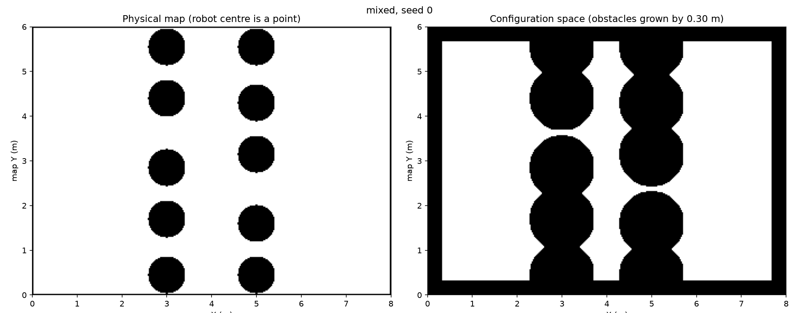

# HW02: Configuration space, PRM and A*

The solution is the ROS 2 Python package [`hw02_planner`](hw02_planner/). It
receives the map, start and goal, builds configuration space, builds a
probabilistic roadmap (PRM), searches it with A*, and drives the route one
waypoint at a time with the supplied `go_to` helper. Planning code
(`grid`, `cspace`, `prm`, `astar`, `planner`) has no ROS dependency, so it is
unit-tested offline; only `planner_node.py` talks to ROS.

## 1. Configuration space

The robot is a disc of radius 0.25 m; with the 0.05 m safety margin we plan with
**r = 0.30 m**. Turning does not change the footprint, so a configuration is the
centre `(x, y)` and configuration space is a 2-D grid with the same size,
resolution (0.025 m) and origin as `/map`.

* **Input cells.** Every value other than 0 is an obstacle, so occupied (100)
  *and* unknown (−1) cells block the robot. The map border is a ring of occupied
  cells, so the walls are inflated by the same rule as the pillars.
* **Inflation.** `scipy.ndimage.distance_transform_edt` gives, for each cell, the
  distance from its centre to the centre of the nearest obstacle cell. An obstacle
  cell is a square, and its nearest corner can be up to half a diagonal closer than
  its centre, so a cell is blocked when

  ```text
  distance_between_centres <= r + resolution / sqrt(2)   = 0.30 + 0.0177 m
  ```

  The added term accounts for the area of the occupied cell, as required.
* **Grid ↔ world.** `column = floor((x − origin_x)/res)`, `row = floor((y − origin_y)/res)`;
  data is row-major (`data[row*width + column]`), rows grow with Y. Figures use
  `origin='lower'` so they match Gazebo and RViz.

The result is published on `/hw02/cspace` (same metadata as `/map`, reliable,
transient-local).

### Which gaps close

A gap between two pillars (radius 0.40 m) is passable only if the free space
between them is at least `2r = 0.60 m`, i.e. the centres are at least 1.40 m apart.
The same 0.60 m is needed between a pillar and a wall. The outer pillars (centres
0.45 m from the wall) leave less than 0.05 m, so **all pillar–wall gaps close**.

| Layout | Pillar spacing along each column | Physical gap | After inflation |
| --- | --- | --- | --- |
| `wide` (x = 3, 5) | 1.70 m everywhere | 0.90 m | all three middle gaps open (0.30 m-wide corridors) |
| `mixed`, x = 3 | 1.25, 1.15, **1.55**, 1.15 m | 0.45, 0.35, **0.75**, 0.35 m | only y ≈ 2.85–4.40 open |
| `mixed`, x = 5 | 1.15, **1.55**, 1.15, 1.25 m | 0.35, **0.75**, 0.35, 0.45 m | only y ≈ 1.60–3.15 open |
| `blocked` (x = 4) | 1.02 m everywhere | 0.22 m | all closed |

The two open `mixed` gaps are on opposite sides of y = 3, so the route must go up
through the first column and down through the second. They are also very narrow
in configuration space: the largest clearance on the line x = 5 is 0.350 m
against a blocking distance of 0.318 m, leaving a corridor only about 6 cm wide
for the robot's centre (about 11 cm at x = 3). The right-hand panels of the
`*_cspace.png` figures show this.



## 2. PRM

* **Sampling.** Points are drawn uniformly over the map extent with
  `numpy.random.default_rng([seed, attempt])`; points in occupied
  configuration-space cells are discarded. Start and goal are added as nodes 0 and 1
  and are connected with the same rules as the samples.
* **Neighbours.** A `cKDTree` gives each node its **k = 12** nearest neighbours
  within **1.5 m**. Each pair is checked once and the graph is undirected.
* **Edge check.** Each candidate edge is walked from end to end in steps of half a
  cell (0.0125 m), endpoints included, so no crossed cell can be skipped. The edge
  is rejected if any point lies in an occupied configuration-space cell or outside
  the map.
* **Why these values.** Uniform samples rarely land inside the 6 cm `mixed`
  corridor, but an edge between nodes on either side of a gap can pass through it.
  Fairly long edges (1.5 m) and k = 12 give such edges a good chance; longer or more
  edges mainly cost time.

### Retry policy and finite budget

Attempts use **1000, 2000, then 5000** samples. Each attempt builds a fresh roadmap
(seed `[seed, attempt]`) and runs A*; the first path found is used. If all three
fail, the node publishes `no_path_found` and sends no movement request.

## 3. A*

A* runs on the roadmap graph with a binary heap. Cost `g` is the sum of Euclidean
edge lengths; the heuristic `h` is the straight-line distance to the goal. `h`
never overestimates, so the first time the goal leaves the queue its path is the
shortest path **in the roadmap**. It is not the shortest path in the continuous
room: it can only use the sampled nodes, which is why the routes zig-zag slightly
and their lengths differ between seeds.

## 4. Execution and failure handling

* The node waits for `/map`, `/hw02/start` and `/hw02/goal` (reliable,
  transient-local), then plans once. `use_sim_time` is enabled inside the node.
* Waypoints are the A* nodes after the start. A 10 Hz timer runs a small state
  machine: send waypoint *i* with `go_to`, keep spinning until its future is done,
  then continue on success or stop the whole sequence on failure (status `failed`).
  Nothing ever blocks inside a callback.
* Statuses on `/hw02/planner_status`: `planning` → `path_found` → `executing` →
  `completed`, or `no_path_found` / `failed`.
* Outputs: `/hw02/cspace`, `/hw02/roadmap` (sphere list of nodes + line list of
  accepted edges), `/hw02/planned_path` (only when a path exists).
* If there is no path the robot is never commanded; the node keeps spinning so the
  observer can confirm the robot stays still.
* On Ctrl+C the node cancels the pending goal and spins briefly so the cancel is sent.

## 5. Build, run and dependencies

Tested on macOS (Apple Silicon) with ROS 2 Jazzy and Gazebo Harmonic from
RoboStack (pixi), because the Ubuntu ARM VM could not run Gazebo. The commands are
the same on Ubuntu, using `setup.bash` instead of `setup.zsh`.

Declared run dependencies (`package.xml`): `rclpy`, `nav_msgs`, `geometry_msgs`,
`std_msgs`, `visualization_msgs`, `hw02_sim`, `python3-numpy`, `python3-scipy`,
`python3-matplotlib`.

```bash
source assignments/hw02/environment/install/setup.zsh
cd assignments/hw02/my_solution && colcon build --symlink-install --base-paths hw02_planner && cd ../../..
source assignments/hw02/my_solution/install/setup.zsh
```

Each run uses a fresh world, with the observer started before the planner:

```bash
ros2 launch hw02_sim simulation.launch.py layout:=mixed gui:=false
ros2 run hw02_sim check_navigation --layout mixed --timeout 300
ros2 run hw02_planner planner_node --ros-args -p seed:=0 -p run_name:=mixed \
    -p figure_dir:=assignments/hw02/my_solution/figures
```

**Readiness:** all seven checks passed before every run (advancing clock, raw map,
start/goal, fresh robot pose, live contact monitoring, map/base TF, go-to helper).
The setup examples `read_map.py` and `move_demo.py` both passed, and the public
tests passed (9 geometry, 12 motion helper).

## 6. Results

RESULTS_TABLE

Sample counts are the samples drawn in the successful (or last) attempt; nodes
include start and goal. Planning time is wall-clock time for all attempts.
"Observer" is the independent `check_navigation` verdict (arrival within 0.10 m,
stopped for two simulated seconds, no wall/pillar contact; for `blocked`,
`no_path_found` and no movement).

FIGURES

## 7. Sampling limitations and the blocked room

For `blocked`, all three attempts (1000, 2000 and 5000 samples) ended with start
and goal in different roadmap components, so the node reported `no_path_found`
and never moved.

A PRM failure alone does **not** prove that no path exists: a finite set of random
samples can miss a narrow passage. `mixed` shows this. Some seeds need the second
or third attempt because 1000 samples happen not to produce an edge through the
6 cm corridor. Testing ten seeds offline, `mixed` needed 1000 samples for seven,
2000 for two and 5000 for one.

What makes `blocked` different is the geometry. Its largest clearance on the
pillar line x = 4 is 0.10 m, far below the 0.318 m blocking distance, so the
inflated pillars and walls form one solid barrier. The free configuration-space
cells around the start and around the goal are separate connected components of
the grid. A connected-component check confirms this, and the `blocked_seed0_cspace.png`
figure shows it. No number of samples could connect them. The PRM result is consistent
with that, but the proof comes from configuration space, not from the PRM.

## 8. Tests

`hw02_planner/test/test_planning.py` (14 tests, all pass) covers:

* world ↔ cell conversion (row = Y, column = X) and points outside the map;
* inflation of a single cell to the planning radius, unknown cells as obstacles,
  wall inflation;
* full-edge checking: an edge with free endpoints but an obstacle in the middle is
  rejected, edges leaving the map are rejected, open-space edges are accepted;
* A* picks the shorter of two routes and returns `None` for a disconnected goal;
* on the supplied rooms: `wide` and `mixed` get paths whose every edge passes the
  check, `blocked` reports no path, and the same seed gives the same path.

```bash
PYTHONPATH=assignments/hw02/my_solution/hw02_planner:$PYTHONPATH python -m pytest -q assignments/hw02/my_solution/hw02_planner/test
```
